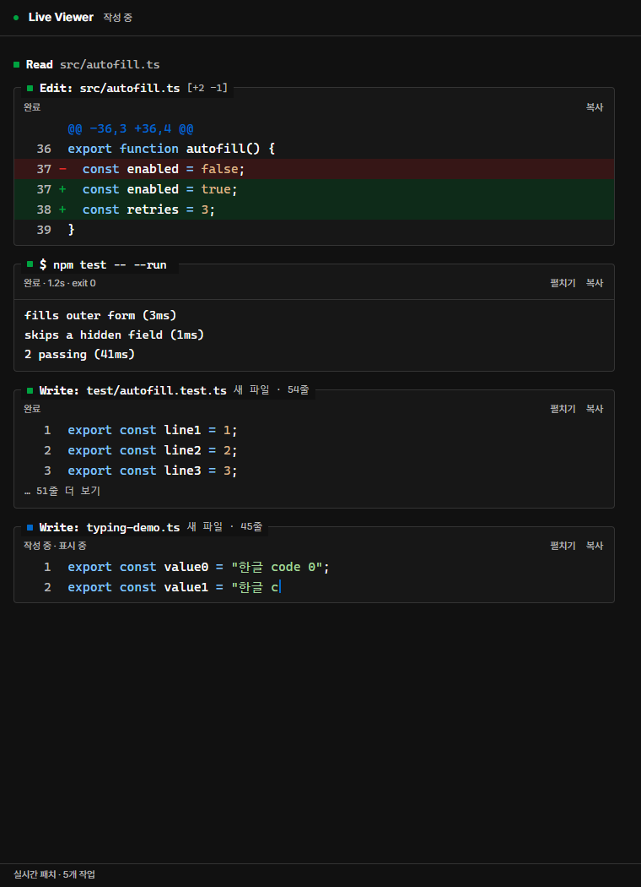

# Codex Live Viewer

Automatic code, diff and execution progress inside the Codex desktop app for Windows.

[한국어](README.ko.md) · [License](LICENSE) · [Attribution](codex-panel/native/reference-NOTICE.txt)

The viewer follows the current local Codex execution and opens in its owning chat when a code tool starts. There is no conversation picker and no additional model run. The panel uses Codex's built-in browser.

## Features

- Chronological Write, Edit and shell cards; compact Read/Grep/Glob rows.
- Syntax colors, diff additions/deletions and available source line numbers.
- A typing effect over received code, with a caret and bounded catch-up.
- Clickable more-lines previews, copy and a TODO tree.
- A native-style 32 px circular return button with animated dots; hover reveals a down arrow without a tooltip.
- Typing is enabled by default, with an uncluttered header.
- Cascadia Code / D2Coding fallbacks; narrow layouts and colors following the Codex app's appearance settings.
- Automatic connection from the ordinary Codex icon after one-time setup.
- Installed Codex components resolved again at launch; application binaries stay untouched.



The image is a renderer fixture. The typing effect is a display animation: it does not imply every tool argument was received token by token. File patches update when the engine emits patch events; other tools appear when their input is available.

## Requirements

Windows, an installed and signed-in Codex desktop app, Node.js 22 or later, and npm. The current connection expects the Windows OpenAI.Codex package and its bundled codex-app-tools server.

This source-only repository contains no Codex binaries, API keys, account settings or captured conversations.

## Build and install

```powershell
git clone https://github.com/leeworm/codex-live-viewer.git
cd codex-live-viewer
npm ci
npm run verify
npm run build
```

1. Open `dist/codex-live-viewer-0.5.4` and run `Enable-Auto.cmd`.
2. Close Codex normally when your work is saved, then start it using your usual icon.
3. Ask Codex to write or edit a file. Live Viewer opens automatically in the owning chat.

Enable-Auto copies the verified bundle into the current user's AppData and registers `CODEX_CLI_PATH`. It preserves the previous value and rejects unrelated overrides. It never stops the running app. To restore the prior setting, run `Disable-Auto.cmd` from the installed bundle.

Typing is applied automatically to newly arriving code. There is no typing or follow toggle in the header. Scroll upward to inspect history, then use the bottom-center ellipsis button to return to the latest work.

The viewer reads only the desktop appearance fields in the active Codex config.toml. App light/dark overrides take precedence over OS mode; system mode follows the OS. Background, foreground, accent and diff colors refresh while the viewer is visible. Configuration is read-only and unrelated settings are never sent to the browser.

Build output folders must be new. To keep an existing build and create another:

```powershell
npm run build -- --output "C:\builds\codex-live-viewer-next"
```

## Development

```powershell
npm run verify
npm run verify:ui
```

The UI check starts an owned, hidden Electron fixture with local HTTP/SSE events. It checks layout, code/diff rendering, typing, completion, clickable expansion, the return control, theme changes and narrow panels. Artifacts go into ignored `artifacts/`. It does not operate the signed-in Codex app or prove a service-model E2E run.

Production dependency license texts are collected from the lockfile's installed packages during build and included with the bundle. The optional generated hook plugin validates real executor ownership metadata and does not change tool input or permissions. Automatic display also works without installing that hook plugin.

## How it works and limitations

A small Windows launcher delegates to the installed stock CLI. A Node observer forwards the existing app-server stream and projects bounded, redacted tool events by host, thread, turn and call identity. The bundled app tool opens a per-chat localhost capability URL, and SSE updates its renderer.

The connection supports local execution on this Windows host. Remote and service-only execution are outside the verified scope. Future app versions must retain the CLI override and bundled panel tool contracts; compatibility is not unconditional.

Completed history is displayed immediately. Newly arriving code is revealed progressively, while the true execution status remains visible. Large display backlogs catch up instead of delaying execution. Structured Write/Edit inputs display source and replacements rather than their JSON envelope; unavailable source positions remain blank.

## Credits

The tool-card presentation and palette draw from [claude-code-live-viewer](https://github.com/moneycode11101-svg/claude-code-live-viewer), which also credits [oh-my-pi](https://github.com/can1357/oh-my-pi). Full notices are retained in [reference-NOTICE.txt](codex-panel/native/reference-NOTICE.txt). The shared redaction helper originates in Chat On Steroids under the retained MIT license.

Older running observers can receive a UI-only update using a color snapshot. Continuous theme synchronization requires the updated observer, activated at the next normal app launch. The viewer does not restart the app.

This is an independent local integration.
